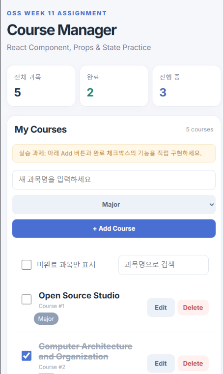
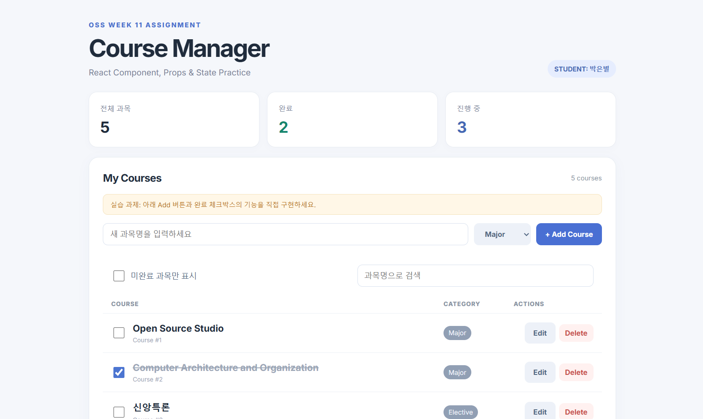

# Assign11 박은별 22300308

## Project Information: 프로젝트 소개, 주요 기능 및 원본 Sample Project URL

과목별 체크리스트를 생성 및 관리할 수 있는 프로젝트. 과목을 새로 생성하고 완료된 과목은 표시하거나 삭제하여 관리 할 수 있음.
[원본 Sample Project URL](https://github.com/2026-2-OSS/week11_sample_project)

## Installation: 설치·실행 방법 및 실행 화면

원본 프로젝트를 fork하여 개인 repo에 저장 -> git clone -> npm install -> npm run dev

 

## Source Code Exploration

1. Project Structure
- ./src/components/CourseItem.jsx : 각각의 객체를 상태에 따라 처리할 수 있도록 함
- ./src/components/CourseList.jsx : 데이터를 관리할 수 있는 주요 기능을 포함
- ./src/App.jsx : 페이지의 전체적인 구조를 담당
2. Component & Props: CourseList가 자식 컴포넌트 CourseItem의 부모 컴포넌트로, 자식 컴포넌트는 부모 컴포넌트에 정의된 객체 및 함수(course, onDelete, onToggle)를 Props로 전달받아 사용한다.
3. State & Event: useState로 course를 정의하고, 초기값을 course에 넣어서 관리. 삭제버튼에 click event가 발생하면 onDelete={handleDelete} 함수가 작동. setCourses와  filter를 이용하여 course값을 새로 설정한다. 
4. Code Analysis: 주요 코드 2개(각 5~15줄)를 선택하여 동작 원리 설명
- ./src/components/CourseItem.jsx:6-12 : checkbox. 체크박스의 초기 상태는 course의 completed값에 따라 결정되며, 상태가 변경 될 경우 onToggle함수를 통해 전달된 course의 id값으로 객체를 찾아 completed상태를 변경한다. 
- ./src/components/CourseList.jsx:7-14 : useState로 courses와 newName을 정의. 초기값은 각각 ./src/data/courses.js에 작성되어있는 초기값과 ''로 설정. setCourses는 삭제 기능이 구현된 handleDelete 함수에서 filter()로 배열을 재정의 하는데 사용되며, setNewName은 새 과목을 추가하는 기능이 구현된 handleAdd 함수에서 새로운 데이터를 입력받을 때 사용됨. 

## Customizing

- 초기 과목 데이터를 자신이 선택한 과목 5개 이상으로 변경
- 프로젝트 제목 및 설명 변경
- CSS 스타일 3곳 이상 변경 : course-title 폰트 사이즈 변경 14->17px / category 배경색과 폰트 색 변경 / check 클래스 높이와 폭 값 변경 17->20px

## Feature Extension: 구현한 기능 2개 이상, 주요 코드 및 동작 결과

- Course Registration (Create): ./src/components/CourseList.jsx:21-32 
과목명을 입력하고 add버튼을 누르면 목록이 업데이트 되며 입력한 과목이 추가됨. 드롭다운을 통해 카테고리도 설정할 수 있음.

- Course Completion (Update): ./src/components/CourseList.jsx:42-46
목록의 과목명 앞에있는 체크박스의 체크 여부에 따라 과목의 완료상태가 변경되도록 함.

- 과목명 검색 기능: ./src/components/CourseList.jsx:66-69
검색창에 입력된 텍스트가 과목명에 포함된 객체만 목록에 표시함

- 완료/미완료 필터링: ./src/components/CourseList.jsx:66-69
미완료 과목만 표시 체크박스를 선택하면 완료상태가 false인 객체만 목록에 표시함.

- 과목명 수정 기능: ./src/components/CourseList.jsx:34-38, 48-53
목록의 edit 버튼을 누르면 과목명 입력 칸에 선택한 과목명이 뜨고, 편집버튼을 누르면 기존 객체에 변경사항이 적용됨.

## Deployment: 실제 접근 가능한 Vercel URL

## Weekly Review:
1. 새롭게 배운 내용 3가지
2. 어려웠던 점과 해결 방법
3. AI 활용 내용 및 느낀 점
설명할 코드 선택, add할때 id파트랑 map 구현할때 ? 이 문법, 드롭다운구현, filter+includes